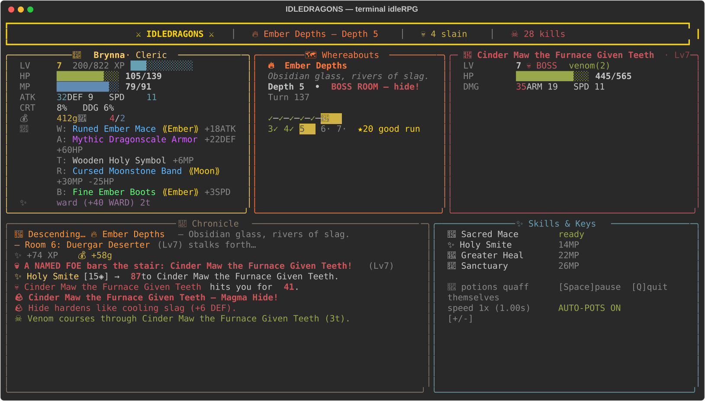

# ⚔ IDLEDRAGONS ⚔

A pretty DnD-themed **terminal idleRPG**. Pick a name and a class, then watch
the dungeon dive unfold on a single screen — no input required beyond that.
Permadeath. Every run ends in the Hall of Fallen Heroes.



## Run it

```bash
uv run --with rich python idlerpg.py
# or
pip install rich && python idlerpg.py
# or, installed:
pip install . && idledragons
```

Optional flags: `--tick SECONDS` (base tick, default 1.0), `--highscores`,
`--reset-highscores`.

Best on a roomy terminal (≥130 columns, ≥30 rows) — the single-screen
layout needs the space.

## Watching

It's a pure watcher: heroes fight, quaff, loot, level, and die by themselves.
Your only keys are `Space` (pause), `+`/`-` (speed, 0.5x–8x), `A`
(auto-potions on/off), and `Q` (abandon run — quitters aren't scored).

## The game

- **7 classes** with distinct kits: Warrior (tanky), Rogue (crits, venom,
  evasion, Ambush opener), Cleric (smites, heals, wards), Wizard (glass cannon),
  Ranger (fast archer, arrows for everything), Paladin (oathbound bulwark),
  Barbarian (enormous HP, reckless cleaves, tiny mana pool). Skills unlock
  at levels 1/3/5; everyone starts with class-flavored Common starter gear.
- **10 creature types** — Beast, Dragon, Undead, Plant, Elemental, Fiend,
  Giant, Humanoid, Monstrosity, Aberration — each with a combat trait. The dead
  ignore poison, fire melts plants, dragons breathe (Rogues evade), elementals
  can't be slowed, humanoids carry fatter purses…
- **40 fixed dungeon levels**, each with a **named boss** sporting a signature
  move: Griznak's War Drum, Vexmar's Soul Siphon, Cinder Maw's Magma Hide,
  Vermithrax's Hoardfire… Boss level comes from the dungeon, so every hero
  faces the same wall. Past 40, the Deep Dark names its own (deterministically —
  same depth, same horror, every run).
- **Champion mobs** (⭐Elder/Alpha/Dire): tougher, richer, better-dropped.
- **Boss Codex**: every roster boss you kill is recorded persistently and shown
  on the `--highscores` screen. Gotta slay 'em all.
- **Loot**: 5 slots (Weapon/Armor/Trinket/Ring/Boots) in 5 rarities, gear sets
  (2+ matching pieces = bonus), and tempting **cursed** pieces with downsides.
- **Highscores** in `highscores.json`: depth, level, and what killed you.
  Design target, verified by simulation: **depth 20 / level 20 is a good run**
  (roughly top quartile; every run eventually dies).

## Develop

```bash
python tests/test_types.py   # trait + loot unit tests (fast)
python tests/sim_balance.py  # 80 headless full runs, death distributions (~minutes)
```
